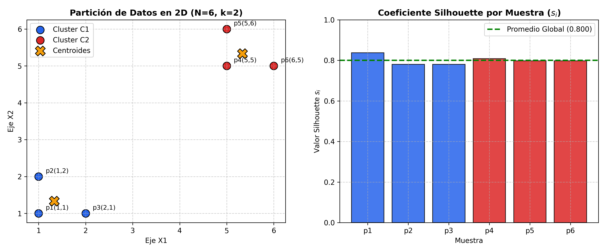

# Actividad 24: Ejemplo Numérico de Índices de Validación Internos de Agrupamiento

**Tecnológico Nacional de México**  
**Instituto Tecnológico Superior de Uruapan**  
**División de Estudios de Posgrado e Investigación**  
**Maestría en Inteligencia Artificial**  

* **Asignatura:** Aprendizaje Automático  
* **Catedrático:** Dr. Roberto Loaeza Valerio  
* **Alumno:** Juan Pablo Figueroa Moran  
* **Matrícula:** M26040059  
* **Repositorio:** [https://github.com/juanpablofm92/Actividad24.git](https://github.com/juanpablofm92/Actividad24.git)  

---

## 📌 1. Descripción General

Este repositorio contiene la implementación y el desarrollo matemático paso a paso de los principales **índices de validación interna de agrupamiento (clustering)** sobre un conjunto controlado en $\mathbb{R}^2$ de $N=6$ observaciones divididas en dos clústeres ($k=2$):

$$C_1 = \{p_1(1,1), p_2(1,2), p_3(2,1)\}, \quad C_2 = \{p_4(5,5), p_5(5,6), p_6(6,5)\}$$

Se calculan de manera analítica manual y se validan computacionalmente mediante `scikit-learn` los siguientes indicadores:
1. **Coeficiente Silhouette ($s_i$ y $s_{prom}$)**
2. **Índice Davies-Bouldin ($DB$)**
3. **Índice Calinski-Harabasz ($CH$)**

---

## 📐 2. Fundamentos Matemáticos

### 2.1 Coeficiente Silhouette
Para cada punto $i$:
$$s_i = \frac{b_i - a_i}{\max(a_i, b_i)}, \quad s_i \in [-1, +1]$$
Donde:
* $a_i$: Distancia euclidiana media de $i$ a los demás puntos de su mismo clúster (cohesión).
* $b_i$: Distancia media de $i$ a todos los puntos del clúster más cercano (separación).
* $s_{prom} = \frac{1}{N}\sum_{i=1}^N s_i \approx 0.8003$.

### 2.2 Índice Davies-Bouldin (DB)
Evalúa la relación de similitud entre pares de clústeres:
$$R_{ij} = \frac{S_i + S_j}{M_{ij}}$$
$$DB = \frac{1}{k}\sum_{i=1}^k \max_{j \neq i} R_{ij}$$
Donde $S_i$ es la dispersión interna promedio al centroide y $M_{ij} = \|c_i - c_j\|$ es la distancia euclidiana entre centroides.  
*Resultado:* $DB \approx 0.2312$ (valores bajos indican mejor partición).

### 2.3 Índice Calinski-Harabasz (CH / Criterio de Ratio de Varianza)
$$CH = \frac{\text{Tr}(B_k) / (k - 1)}{\text{Tr}(W_k) / (N - k)}$$
Donde $B_k$ es la dispersión inter-cluster y $W_k$ es la dispersión intra-cluster.  
*Resultado:* $CH = 72.00$ (valores altos indican alta separación y compactación).

---

## 🚀 3. Estructura del Repositorio

```
Actividad24/
├── README.md
├── requirements.txt
├── .gitignore
├── docs/
│   └── cluster_validation.png
└── src/
    └── main.py
```

---

## 💻 4. Instalación y Ejecución

```bash
# 1. Clonar el repositorio
git clone https://github.com/juanpablofm92/Actividad24.git
cd Actividad24

# 2. Instalar dependencias
pip install -r requirements.txt

# 3. Ejecutar el cálculo y verificación
python src/main.py
```

---

## 📊 5. Visualización Generada

El script genera automáticamente la gráfica `docs/cluster_validation.png` que muestra la partición de los puntos en el plano bidimensional y el perfil de coeficientes Silhouette por muestra:


